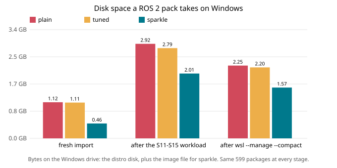

# Sparkle

**Disposable, smaller WSL environments for ROS and other Linux work, one command each.**

> **Status: design + working boot prototype + reproducible benchmarks + a first `sparkle` CLI ([cli/](cli)): `add`, `enter`, `ls`, `reset`, `eject` work end to end on one PC. `add ros` takes ~23 s once the image is downloaded (not yet the 15 s goal), plus the download.**
> This repo publishes the measurements behind the design, including the ones that don't favour it, so you can check them before anything ships.

## The problem

A default WSL distro is a virtual disk file that only grows:
- Install ROS, build things, remove them, and Windows keeps the space.
- `wsl --manage --compact` gives some of it back, until the next big install.
- WSL's opt-in sparse mode can shrink disks, but it has open bugs, can't be compacted, and wasn't benchmarked here.
- A second clean environment means another 1+ GB copy of Ubuntu.

## The idea

A Sparkle pack is a normal WSL distro: VS Code, Windows Terminal, `\\wsl$`, the GPU and WSLg all work as usual. Its files live in three places:

```
/usr, /opt                        ->  read-only image file on NTFS (fixed size, shareable)
/etc, /var, /home, your packages  ->  small writable disk
/tmp, apt lists, caches, logs     ->  RAM (tmpfs, ~100 MB)
```

The image is mounted by a tiny stub during WSL's own boot, before any shell starts ([proto/](proto)).
- **Reset** drops every package installed on top of the image and restores the package database.
- **Eject** deletes the files.

## What the measurements say

Same ROS 2 Jazzy `/usr` and `/opt` (byte-identical, verified by hash), as a plain WSL distro and as a Sparkle pack:

| | plain WSL | Sparkle |
|---|---|---|
| Disk on Windows, fresh | 1,118 MB | **460 MB (−59%)** |
| … after the same workload | 2,924 MB | **2,006 MB (−31%)** |
| … after `wsl --manage --compact` | 2,252 MB | **1,571 MB (−30%)** |
| Back to the original package set | apt purge to a list, or re-import | **reset, 1.7 s** |
| Cold start / new login shell | 536 / 900 ms | 640 / 1,084 ms (**+0.1–0.2 s**) |
| First Python/ROS/C++-header command after the cache is dropped | 1× | **~2× slower** |
| Same, warm | 1× | Python/ROS **~20% slower**; C++ compile the same |
| `colcon build`, `apt install` (134 pkgs) | 20.2 s, 32.0 s | 18.0 s, 34.0 s (ranges overlap) |
| nvidia-smi, OpenGL D3D12, WSLg, interop, ROS pub/sub… | 18/18 checks | 18/18 checks |
| VM killed mid-`apt install`; 4 terminals opened at once | recovers; 20/20 | recovers; 20/20 |
| `wsl --export` backup (file data) | 19.7 s, 939 MB | 1.5 s, 32 MB **+ the 336 MB image** |



**This is a trade, not a free win.**
- **What you gain:** 59% less disk when fresh and about 30% less after use, plus a 2-second reset of the package set.
- **What you pay:**
  - 0.1–0.2 s per cold start or new shell
  - about 2× on first reads after the cache is dropped
  - about 20% on warm Python/ROS startup
- **Not solved yet:**
  - The writable disk still keeps its high-water mark.
  - If the image file goes missing, WSL itself only says `execvpe(/bin/bash) failed`. `sparkle enter` now checks first and names the missing file.
  - Reset doesn't yet clear `/etc` and `/var`, or shrink the file.

The fix is designed (spike S18) but not measured. Full numbers and caveats: [docs/results.md](docs/results.md).

## Why you can trust these numbers (or check them yourself)

- **Same bytes.** All three variants are cut from one extracted image. Their `/usr` and `/opt` have identical metadata and content hashes (S10).
- **A control variant.** "tuned" is plain WSL plus the same tmpfs settings, done by hand. It separates what the image layout does from what tmpfs does, and plain vs tuned shows the noise floor.
- **Fair runs:**
  - variants interleaved run by run
  - medians with min–max and n
  - no network in any timed step
  - every startup timing also checks that the boot worked
- **Raw data is in the repo.** Every number traces to `bench/results/raw/*.jsonl` (final run of each spike), which `bench/summarize.py` turns into [the summary](bench/results/summary.md).
- **Independent review.** Two reviewers audited the write-up against the raw data. Their corrections are applied, and the bugs they found in the harness are fixed and re-measured.
- **Limits are written down:** one machine, one image, guest-cold not host-cold, synthetic workload, run history, and what's untested. See [docs/methodology.md](docs/methodology.md).

## Reproduce

Requirements:
- Windows 11 + WSL 2
- Git Bash and Python 3
- `crane`
- a helper distro with `mksquashfs` 4.6 or later
- a static busybox

```bash
crane pull --platform linux/amd64 ros:jazzy-ros-base image.tar
bash bench/s10-fixtures.sh image.tar                 # builds spb-plain, spb-tuned, spb-sparkle
bash bench/s11-startup.sh                            # restarts WSL ~30 times (see warning)
bash bench/run-quiet.sh s12-tools s13-build s14-apt s17-compat s15-bloat
python bench/summarize.py
```

Warnings:
- S11 and S16 restart the WSL VM many times. Windows re-attaches virtual devices and refreshes File Explorer each time.
- `run-quiet.sh` keeps the distros running so the other spikes don't restart anything.
- Nothing is ever deleted. Clean up with `wsl --unregister spb-<variant>` when you're done.

## Repo map

| Path | What |
|---|---|
| [docs/design.md](docs/design.md) | Sparkle v1 design (Rust CLI, OCI images, catalog, networking) and spikes S1–S9 |
| [docs/results.md](docs/results.md) | Benchmark results S10–S17 and the design changes they forced |
| [docs/methodology.md](docs/methodology.md) | How the benchmarks were run, and their limits |
| [cli/](cli) | The `sparkle` CLI (Rust, first cut) and its end-to-end run |
| [proto/](proto) | The boot prototype: stub `mount`, `init.sh`, fixture builder |
| [bench/](bench) | The harness: one script per spike, guest scripts, raw results, summarizer |
| [AGENTS.md](AGENTS.md) | Ground rules and pitfalls for agents (and humans) working here |

## License

MIT
