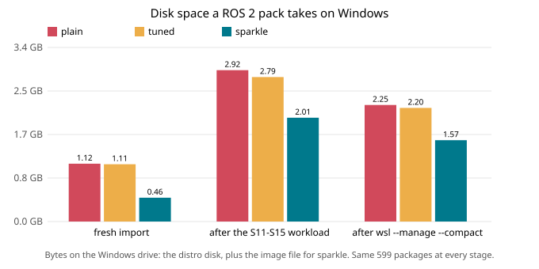

# Results: Sparkle layout vs plain WSL

Benchmark spikes S10–S20, run 2026-10-30/31; S18, S19, the second image and the CLI re-run on a quiet machine on 2026-11-01.
- Every number below comes from [bench/results/summary.md](../bench/results/summary.md), except the second image and S20, which come from [bench/results-python/summary.md](../bench/results-python/summary.md).
- That summary is generated from the raw measurements in [bench/results/raw/](../bench/results/raw).
- How the runs were made fair, and what they don't show, is in [methodology.md](methodology.md). Read that page before quoting any of this.

**Machine:**
- Windows 11 Home, i7-13650HX, 48 GB RAM, Samsung NVMe, RTX 4060 Laptop GPU
- WSL 3.0.3, kernel 6.18.54

**Software:** `ros:jazzy-ros-base` (Ubuntu 24.04 + ROS 2 Jazzy, 599 packages) in three variants. All three are cut from one extracted image, so `/usr` and `/opt` are byte-identical (S10):

| Variant | What it is |
|---|---|
| **plain** | The image imported as a normal WSL distro |
| **tuned** | plain + Sparkle's scratch-on-tmpfs settings, applied by hand with `/etc/fstab`. This is the control: plain vs tuned shows how much tmpfs alone does, and how big the run-to-run noise is. |
| **sparkle** | `/usr` + `/opt` as a read-only squashfs image file on NTFS + a small writable disk, with the same tmpfs settings |



## Summary

| | plain | sparkle | Difference |
|---|---|---|---|
| Disk on Windows, fresh | 1,118 MB | **460 MB** | **−59%** |
| Disk after the test workload (still 599 packages) | 2,924 MB | **2,006 MB** | −31% |
| Disk after `wsl --manage --compact` | 2,252 MB | **1,571 MB** | −30% |
| Data really on the writable disk (`df`) | 1,053 MB | **50 MB** | System files live in the image |
| Back to the original 599 packages | apt purge to a list, or re-import | **reset: 1.7 s boot**, n=1 | See S15 for what reset does and doesn't clear |
| Start a stopped distro (VM up) | 536 ms | 640 ms | +103 ms |
| Start after `wsl --shutdown` | 1,706 ms | 1,864 ms | +159 ms |
| New login shell (sources ROS `setup.bash`) | 900 ms | 1,084 ms | +184 ms |
| Run a command in a running distro | 164 ms | 168 ms | Same |
| `import rclpy`, guest cache dropped | 470 ms | 845 ms | 1.8× slower |
| `import rclpy`, warm | 172 ms | 205 ms | +19% (+30% vs tuned) |
| Compile against rclcpp headers, cold / warm | 2.06 / 1.96 s | 3.85 / 1.98 s | 1.9× slower cold, same warm |
| `colcon build`, 5 packages | 20.2 s | 18.0 s | Same (ranges overlap) |
| `apt install` of 134 packages | 32.0 s | 34.0 s | +6% (n=3, ranges overlap) |
| Compatibility checks | 18/18 | **18/18** | Same |
| Cold starts that came up correctly | 20/20 | **20/20** | No failures |
| 4 terminals opened at once, stopped distro | 20/20 | **20/20** | No failures |
| VM killed mid-`apt install`, then `dpkg --configure -a` + `apt-get install -f` | recovered | **recovered** | n=1 each |
| `wsl --export` (backup), file data | 19.7 s, 939 MB | **1.5 s, 32 MB** | Sparkle's leaves out the 336 MB image |

**Bottom line:**
- **Sparkle wins on space.** A fresh pack takes 59% less disk. A used pack takes about 30% less, because system files stay in a fixed-size image.
- **Sparkle can reset the package set** in about 2 s. With the S10–S17 layout, reset doesn't shrink the disk file or clean `/etc` and `/var`. With S18's upper file it does both: package configs, dpkg state and the space go with the file.
- **Sparkle loses on speed:**
  - about 0.1–0.2 s per cold start or new login shell
  - about 2× on the first read of many files after the guest cache is dropped (a Windows reboot is likely worse)
  - about 20% on warm Python/ROS command startup (30–37% vs tuned)
  - CPU-bound work (compiling, building) is the same.
- **Failures recover like plain WSL.** A VM killed mid-install was repaired by the usual `dpkg --configure -a` + `apt-get install -f` (n=1 per variant). The one Sparkle-only failure tested, a missing image file, shows a confusing error (S16).
- **Disk growth is solved for installed packages, at a price (S18).** With the upper layer in its own file, reset returned the pack to exactly the same size twice (490 MB, from 1.73 and 1.85 GB). The price: installs about 50% slower, and the upper file over-allocates while in use. The seed disk (`/home`, logs) still keeps its high-water mark.
- **Most of the speed cost has a fix (S19).** Switching the image from squashfs to erofs removes the warm cost and 38–75% of the cold gap for Python/ROS/C++ commands, for +124 MB of image. A cold metadata walk loses squashfs's edge (459 → 714 ms, level with plain). It needs the erofs kernel module loaded at boot, which the pack can't do yet.
- **The approach is not ROS-specific.** A Debian `python:3.12` image shows the same disk saving (−56%) and the same "slower cold, same warm" shape.

## S10 — Same bytes in every variant

Before comparing anything, S10 checks that the variants really hold the same system. It fingerprints `/usr` and `/opt` in each booted distro:
- the sorted metadata of every entry (path, type, mode, owner, link target, file size)
- the sha256 of every file's content

WSL's own mounts under `/usr` are excluded. `/etc` differs on purpose: each variant has its own boot and tmpfs settings.

| | plain | tuned | sparkle |
|---|---|---|---|
| Entries | 38,516 | 38,516 | 38,516 |
| Metadata hash | `ebb8feac4d2b5dc0` | `ebb8feac4d2b5dc0` | `ebb8feac4d2b5dc0` |
| Content hash | `b4173a482cb02bd8` | `b4173a482cb02bd8` | `b4173a482cb02bd8` |
| Import time | 3.1 s | 6.0 s | **1.05 s** (the seed only) |
| Disk at rest | 1,118 MB | 1,107 MB | **460 MB** = 336 MB image + 124 MB disk |

- Building the image and seed takes 13.7 s.
- In Sparkle v1 that build happens once, in CI, and users download the result.

**This check caught four bugs in the prototype.** An earlier version failed it. They're fixed now:

1. **WSL's kernel mounts were hidden.** WSL 3.0.3 mounts the kernel modules, headers and `perf` tools under `/usr` (`/usr/lib/modules/<kver>`, `/usr/src/linux-headers-<kver>`, `/usr/lib/linux-tools/<kver>`). The overlay hid them. The boot script now parks every mount under `/usr` and `/opt` and restores it after mounting the overlay.
2. **`wslpath` and `wslinfo` were missing.** WSL creates them in `/usr/bin` at boot, which put them under the overlay. They're now re-linked.
3. **The root directory was mode 700.** The seed's `/` came from a `mktemp -d` directory, so non-root users couldn't `cd /`.
4. **Three directories were world-writable.** Directories re-created at boot came out mode 777, because the boot script runs with umask 0.

The fixes were applied to the live `spb-sparkle` and S10 re-run; see [methodology.md](methodology.md).

## S11 — Startup (n = 10 per cell, variants interleaved)

Timed from Windows: how long `wsl.exe` takes until a command runs inside the distro. The command fails if the image isn't mounted, so each timing also checks that the boot worked.

| Start | plain | tuned | sparkle |
|---|---|---|---|
| After `wsl --shutdown` (VM boot) | 1,706 ms | 1,750 ms | 1,864 ms |
| Distro stopped, VM up | 536 ms | 565 ms | 640 ms |
| Distro running | 164 ms | 168 ms | 168 ms |
| Login shell (sources ROS `setup.bash`) | 900 ms | 916 ms | 1,084 ms |

- All 120 measurements succeeded, including 20 of 20 cold starts per variant.
- Mounting the image costs about 0.1–0.16 s per cold start.
- Every new terminal pays about 0.18 s more, because `setup.bash` reads many small files through the overlay and squashfs.

## S12 — Tool speed (n = 5; cold = guest page cache dropped before each step)

Python, `ros2` and colcon steps run as the `dev` user through a login shell (`su - dev -c`), so their timings include sourcing ROS's `setup.bash`. A warm-up pass runs before the warm loop.

| | plain | tuned | sparkle |
|---|---|---|---|
| Read all of `/usr` + `/opt`, cold | 5.98 s | 6.57 s | 6.77 s |
| Walk metadata, `find` over `/usr` + `/opt`, cold | 709 ms | 733 ms | **419 ms** |
| Login shell + `import rclpy`, cold | 470 ms | 438 ms | 845 ms |
| Login shell + `ros2 pkg list`, cold | 603 ms | 569 ms | 1,225 ms |
| `g++ -fsyntax-only` on rclcpp headers, cold | 2.06 s | 2.06 s | 3.85 s |
| Read all, warm | 542 ms | 546 ms | 792 ms |
| Walk metadata, warm | 39 ms | 42 ms | 177 ms |
| Login shell + `import rclpy`, warm | 172 ms | 158 ms | 205 ms |
| Login shell + `ros2 pkg list`, warm | 252 ms | 219 ms | 299 ms |
| `g++` on rclcpp headers, warm | 1.96 s | 2.00 s | 1.98 s |

**How to read this:**
- **Noise floor.** plain and tuned have identical `/usr`, so their gap is noise plus tmpfs. Here it's up to 15% (warm `ros2 pkg list`). Only read a sparkle gap well beyond that as real.
- **Cold reads cost more.** Squashfs has to decompress, so cold reads of many small files are about 1.8–2× slower: Python imports, `ros2`, C++ headers.
- **Cold metadata walks are faster.** Squashfs keeps metadata compact, so a cold `find` is 1.7× faster.
- **Warm compiling is the same.** It's CPU-bound.
- **Warm metadata-heavy work stays slower.** Python imports and `ros2` are about 20% slower than plain (30–37% vs tuned) and a `find` about 4.5× slower, because every lookup goes through the overlay.
- **The cold numbers likely understate the cost.** "Cold" means the guest cache was dropped. The Windows file cache, which holds the image file, could not be dropped. A first command after a Windows reboot is likely slower than shown.

## S13 — Building a ROS 2 workspace (n = 3)

`colcon build` of 4 C++ packages (an rclcpp node each) and 1 Python package, built from clean on the writable disk:

| plain | tuned | sparkle |
|---|---|---|
| 20.2 s (19.9–20.3) | 20.0 s (19.4–20.2) | 18.0 s (16.2–20.9) |

No measurable difference: the ranges overlap.

## S14 — Installing and removing packages (n = 3)

The package set is `mesa-utils python3-scipy ripgrep jq htop gdb`, which pulls in 134 packages (112 MB of `.deb`s).
- Installs run through `apt-get --no-download` from local copies.
- The one-time download happened before the timed runs. Its `apt update` took 121 s, mostly 10 s timeouts against `packages.ros.org`, which this network can't reach.

| | plain | tuned | sparkle |
|---|---|---|---|
| Install | 32.0 s (30.9–33.0) | 31.7 s (31.3–31.9) | 34.0 s (31.4–34.7) |
| Remove (`purge` + `autoremove`) | 20.2 s | 20.4 s | 20.5 s |
| Guest disk use after install | +533 MB | +509 MB | +509 MB |
| Packages `autoremove` left behind | 18 | 18 | 18 |
| `dpkg --audit` problems | 0 | 0 | 0 |

- apt and dpkg work correctly on the overlay.
- Sparkle's median install is 6% slower than plain, but with n=3 and overlapping ranges, that isn't established.
- `purge` + `autoremove` leaves the same 18 packages on every variant. The harness then purges them (untimed) to return to the exact 599-package baseline.
- The extra 24 MB on plain is apt's binary package cache, which tuned and sparkle keep in RAM.

## S15 — Disk growth, compaction and reset

By S15's start, every variant had been through S11–S14 and S17, which install and remove the S14 package set several times. Each was back to exactly the original 599 packages.

| | plain | tuned | sparkle |
|---|---|---|---|
| On Windows, fresh (S10) | 1,118 MB | 1,107 MB | 460 MB |
| On Windows, at S15's start | 2,824 MB | 2,724 MB | 2,006 MB |
| … after 5 rounds of use | 2,924 MB | 2,791 MB | 2,006 MB |
| Data really stored (`df` used) | 1,053 MB | 994 MB | 50 MB |
| After `wsl --manage <d> --compact` (about 7 s, distro stopped) | 2,252 MB | 2,196 MB | 1,571 MB |
| RAM held by the tmpfs paths | 0 | 100 MB | 100 MB |

Each round:
1. replays `apt update`
2. installs the S14 set
3. builds the workspace and runs a ROS node for 8 s
4. imports SciPy and rclpy
5. removes the packages, runs `apt-get clean`, and deletes the build output

What this shows:
- **Disk files track their peak, not their contents.** Every disk is 2–3 GB while holding 0.05–1 GB of data. After the first heavy use, more rounds add little: +100 MB plain, +67 MB tuned, 0 sparkle.
- **Compaction is partial and temporary:**
  - It takes back 0.4–0.7 GB, and repeats the same result run to run: 2,252 / 2,196 / 1,571 MB here, against 2,253 / 2,187 / 1,570 MB in an earlier run.
  - It leaves more than 1 GB of empty space in each disk.
  - The next heavy use grows it straight back. After the earlier compaction, re-running S17 (one install and removal) took the disks back to 2,824 / 2,724 / 2,006 MB.
- **Sparkle's lead comes from the image alone.** Its writable disk grows like any other: 1,235 MB of file for 50 MB of data. Sparkle stays about 0.7–0.9 GB smaller only because the system files never enter that disk.

**Reset (Sparkle only, n=1):**
1. Left the 134 packages installed (733 total).
2. Ran reset: touched `/.sparkle/reset` and restarted the distro.
3. The next boot took 1.7 s.
4. Result: 599 packages, and an upper layer of 15 bytes (effectively empty).

What the prototype's reset doesn't do yet:
- Files packages wrote to `/etc` and `/var` stay (configs, alternatives links, state). The design's fix is to overlay those too.
- The disk file doesn't shrink.

On plain WSL, the same package set comes back by purging to a saved list (what this harness does, leaving those `/etc` and `/var` remnants too) or by re-importing (which loses `/home`).

## S16 — Failure modes

What happens when things go wrong, and does the pack recover? Script: [bench/s16-robust.sh](../bench/s16-robust.sh). It kills the WSL VM 6 times when run in full.

**Four terminals opened at once on a stopped distro** (5 rounds per variant): 4 of 4 came up with the image mounted in every round, on all three variants.

**Power cut during `apt install`** (n = 1 per variant): the harness starts the S14 install (134 packages), waits until `dpkg` is running, waits 1 s more, then runs `wsl --shutdown`.

| | plain | tuned | sparkle |
|---|---|---|---|
| Cut at (dpkg seen running) | 8.0 s | 7.2 s | 8.4 s |
| Boots afterwards, image mounted | yes | yes | yes |
| New packages fully installed / half-done | 6 / 2 | 5 / 3 | 7 / 1 |
| `dpkg --audit` lines before repair | 12 | 10 | 8 |
| `dpkg --configure -a`, `apt-get install -f`, `apt-get check` | all rc 0 | all rc 0 | all rc 0 |
| `dpkg --audit` lines after repair | 0 | 0 | 0 |
| Same install run again, on the repaired system | rc 0 | rc 0 | rc 0 |
| Back at the 599-package baseline afterwards | yes | yes | yes |

- The cut really landed mid-install: on every variant, 8 of the 134 packages the install adds were fully or partly installed afterwards.
- Sparkle's overlay recovered the same way as a plain ext4 root. The standard repair (`dpkg --configure -a`, then `apt-get install -f`) was enough, and nothing Sparkle-specific was needed. `dpkg --audit` was checked only after both steps, so this doesn't show which one did the work.
- `wsl --shutdown` kills the VM, not the host. Writes the VM had already handed to Windows may still have reached the disk. A real power loss of the laptop was not tested.
- Each cut lands at one moment in the install, so n = 1 per variant shows that recovery *can* work, not that it always does.

**Image file missing** (sparkle only; the image was moved away, then put back):
- What the user sees, 1.9 s after launching: `execvpe(/bin/bash) failed: No such file or directory`. This doesn't say what is wrong. WSL starts the shell before the boot script has given up waiting for the image.
- The boot log does name the cause: `IMAGE MISSING: <path>`, logged after the boot script's 5 s wait.
- With the image back in place, the pack boots and the image mounts again (n=1). The writable disk was not checked separately.

**`wsl --export`** (what most WSL users do for backups):

| | plain | tuned | sparkle |
|---|---|---|---|
| Time | 19.7 s | 18.8 s | **1.5 s** |
| Entries in the archive (files, dirs, links) | 41,521 | 41,646 | 5,229 |
| File data (sum of member sizes, not the archive size) | 939 MB | 879 MB | **32 MB** |

- Sparkle's export holds only the writable disk: `/etc`, `/var`, `/home` and anything installed over the image. The image (336 MB, S10) is not in it. **A Sparkle backup is that export plus the image file**, or the image's name, if it can be pulled again.
- Restoring an export with `wsl --import` was not tested for any variant.

An earlier full run of S16 had a test bug. Its power cut fired 6 s after starting the install, but copying the `.deb` files to RAM takes longer than that, so dpkg had never started (`/var/log/dpkg.log` showed no activity; those rows were replaced by the re-run and not kept). It also read the boot log before the "image missing" line was written. Both were fixed, and only those two sections were re-run. The concurrent-start and export rows come from the first run.

## S17 — Compatibility (every check on every variant)

All 18 checks pass on all three variants:
- default user, passwordless sudo
- `cmd.exe` interop, `/mnt/c`, `wslpath`, `wslinfo`, DNS
- WSLg X11 socket, WSLg Wayland socket (checked in a real `wsl.exe` user session)
- `nvidia-smi -L` (RTX 4060), `/dev/dxg`, OpenGL renderer = D3D12 (NVIDIA)
- `ros2` CLI (194 packages), ROS 2 pub/sub
- SciPy, gdb
- `dpkg --audit` clean, `apt-get check`

Notes:
- A 19th, informational row records `/tmp`'s type: tmpfs on tuned/sparkle; on plain, `/tmp` is part of the root disk. WSLg's X11 socket works with tmpfs `/tmp`.
- **Not tested:** CUDA compute (only `nvidia-smi` device listing), VS Code Remote-WSL, Windows Terminal profiles, systemd, Docker, RViz/Gazebo.

Earlier runs of S17 had three test bugs, fixed before these results:
- WSLg checks ran through `su`, which drops `DISPLAY`.
- `cmd.exe` swallowed the rest of the test script from stdin.
- Two "ping/capabilities" checks could not fail, because this image has no `ping`. They were removed.

## Second image: `python:3.12-bookworm` (Debian 12, no ROS)

Does the layout hold for an image that isn't Ubuntu or ROS? First run 2026-10-31; re-run in full on 2026-11-01 on a quiet machine (see [methodology.md](methodology.md#the-quiet-re-run-2026-11-01)) with `bash bench/run-python.sh`. The tables show the quiet re-run.
- Numbers come from [bench/results-python/summary.md](../bench/results-python/summary.md), generated from [bench/results-python/raw/](../bench/results-python/raw).
- Image: `python:3.12-bookworm@sha256:034c3e9d…317a0` (linux/amd64), a 964 MB tree with Python 3.12.16 in `/usr/local` and gcc.
- No `wsl --shutdown`, so there are no VM-cold rows. n = 5 per cell.
- The first run shared the VM with three other benchmark sessions. Its data is in git history (commits f998d24 and 330ad8b, `bench/results-python/raw/`). The quiet re-run agrees with it on the direction of every headline, but some ratios moved: vs tuned, cold `pip --version` 4.5× → 2.3× and stdlib import 1.7× → 2.6×; cold `gcc` 3.3× → 3.8×; warm metadata walk 2.3× → 3.5×; start-time cost +223 → +144 ms. `apt_install_jq` now passes.
- **Not run (time box):** S11 VM-cold, S13 build, S14 apt timing, S15 growth/compaction/reset, S16 failure modes, offline `.deb` install, restore onto a second PC.
- Limits are in [methodology.md](methodology.md#second-image-python312-bookworm-and-s20-exportrestore).

No change to `proto/` was needed. The stub, `init.sh` and the build script worked as-is on Debian. The harness change is image-profile knobs: probe file, guest scripts, tree path, and no VM restarts. The defaults are the ROS image's.

| Headline | ROS image (above) | Python image | Holds? |
|---|---|---|---|
| Same bytes in every variant (S10) | yes | **yes**: 27,542 entries, meta + content hashes equal | yes |
| Disk on Windows, fresh: plain → sparkle | 1,118 → 460 MB, **−59%** | 1,187 → 526 MB, **−56%** (412 MB image + 113 MB disk) | yes |
| Start a stopped distro (VM up) | 536 → 640 ms, +103 ms | 590 → 734 ms, **+144 ms** (plain 568–617, sparkle 640–969 ms) | yes |
| Run a command in a running distro | same | 171 vs 172 ms, same | yes |
| New login shell | +184 ms (ROS `setup.bash` reads from the image) | 169 vs 184 ms, ranges overlap (nothing to source) | n/a |
| Walk metadata, cold | 0.59× (faster) | 470 → 233 ms, **0.50×** (faster) | yes |
| Read all of `/usr` + `/opt`, cold | 1.13× | 5.54 → 7.25 s, **1.31×** | yes, a bit worse |
| Main tool, cold | `import rclpy` 1.8×; `g++` on rclcpp 1.9× | `gcc` small C file 86 → 325 ms, **3.8×**; vs tuned: stdlib import 2.6×, `pip --version` 2.3× | yes, worse |
| Main tool, warm | `g++` same; `import rclpy` +19% | `gcc` 27 vs 32 ms (tuned 33), same; stdlib import 80 vs tuned 85 ms, same; pip same | yes, even better |
| Walk metadata, warm | 4.5× (39 → 177 ms) | 3.5× (25 → 87 ms) | yes |
| Compatibility (S17) | 18/18 | **18/19 on every variant** (plus the informational `/tmp` row). The one failure is the same on all three (see below) | yes |

**So the result is not ROS-specific.** The disk saving, a start-time cost, and the "slower cold, same warm" shape all repeat on a Debian image with a different layout (`/usr/local`, empty `/opt`).

S12 (tool speed, ms, median of 5):

| | plain | tuned | sparkle |
|---|---|---|---|
| Read all of `/usr` + `/opt`, cold / warm | 5,537 / 698 | 5,378 / 630 | 7,247 / 787 |
| Walk metadata, cold / warm | 470 / 25 | 486 / 27 | 233 / 87 |
| Login shell + import 11 stdlib modules, cold / warm | 478 / 359 | 142 / 85 | 370 / 80 |
| Login shell + `pip --version`, cold / warm | 735 / 584 | 202 / 164 | 474 / 162 |
| `gcc -O2` small C file, cold / warm | 86 / 27 | 82 / 33 | 325 / 32 |

**Why plain is slow on Python here:** on this image, `plain` is about 4× slower than tuned *and* sparkle on warm Python steps (stdlib import 359 vs 80–85 ms, `pip` 584 vs 162–164 ms). The official `python` image deletes its compiled `.pyc` files (0 under `/usr/local/lib/python3.12`, checked after the run), and user `dev` can't write there. So on plain, Python recompiles every module it imports, on every run. Tuned and sparkle set `PYTHONPYCACHEPREFIX` to `/tmp` (part of the tmpfs settings), so their compiled cache survives between runs. This is a real-world benefit of the tmpfs settings on images built like this, not of the image layout. The fair comparison for Python steps is therefore sparkle vs **tuned**: 2.3–2.6× slower cold, the same warm. Cold sparkle times have wider ranges than plain's (for example `gcc` 218–475 ms).

S17: all three variants pass the same 18 checks (plus an informational row recording `/tmp`'s type):
- default user, `cmd.exe` interop, `/mnt/c`, `wslpath`, `wslinfo`, DNS
- `nvidia-smi -L`, `/dev/dxg`, WSLg X11 and Wayland sockets
- Python 3.12.16, pip 25.0.1, stdlib (sqlite 3.40.1, OpenSSL), `venv`, gcc hello-world
- `dpkg --audit` clean, `apt-get check`, `apt-get install jq` from the Debian mirror

One check fails, identically on all three variants: `gpu_opengl_d3d12`, because this image has no `glxinfo`. Expected. (In the first run `apt_install_jq` also failed on all three, because `apt-get update` couldn't reach the mirror. It passed in the quiet re-run.)

### Export and restore (S20)

S16 timed `wsl --export` but never restored a backup. S20 exports the plain and sparkle variants, imports each as a new distro and boots it. It ran on the Python image; the steps don't depend on the image.

| | plain | sparkle |
|---|---|---|
| Export stream size | 1,066.4 MB | **22.8 MB** |
| Export piped into `wsl --import` | 22.8 s | 1.5 s |
| Restored distro boots, image mounted, `python3 --version` runs as `dev` | yes (926 ms) | **yes** (918 ms) |

What a Sparkle backup does and doesn't contain:
- **`wsl --export` of a pack does not contain the image.** It holds only the small writable disk: the seed, `/etc`, `/home`, `/var` and the overlay's upper layer. The 412 MB image is a separate file on NTFS. The pack finds it by the absolute path in `/.sparkle/image`.
- **The image still in place:** the restored pack works unchanged (row `restored_*`).
- **The image not at that path** (another PC, or the folder moved): boot fails. A command returns rc=1 in 437 ms, and `/.sparkle/boot.log` says `IMAGE MISSING: <path>`. This is the same failure as S16's missing image (row `moved_image_*`).
- **Fix:** put the image anywhere, write its WSL path into `/.sparkle/image`, then `wsl -t <distro>`. The next start mounts it and Python runs (row `repointed_*`, 1,093 ms). The write uses `/.sparkle/bin/busybox`, because nothing under `/usr` exists while the image is missing.

Backup procedure for a Sparkle pack, as tested here (n = 1 per case; a restore onto a second PC was not tried):

```
wsl --export <pack> pack.tar                  # small: user data + writable layer
copy <image.sqfs> to the backup next to it      # the image is NOT in pack.tar
# restore:
wsl --import <pack> <dir> pack.tar --version 2
wsl -d <pack> -u root --exec /.sparkle/bin/busybox sh -c 'echo /mnt/c/<new path>/image.sqfs > /.sparkle/image'
wsl -t <pack>
```

For the real tool, this means `sparkle export` should bundle the image, or record its digest so the image can be re-fetched. It should also re-point `/.sparkle/image` on import.

What went wrong during the first run (2026-10-31), recorded rather than hidden. The quiet re-run had none of these problems:
- **The first restore of `plain` came out broken** (no `dev` user, rc=127). C: had filled to 100% during its import: the 1 GB export tar was written while the shared disk was nearly full. After freeing space, S20 streamed the export straight into the import (no tar on disk) and restored plain again as `spb2i-restore2-plain`. The first run's plain row came from that second import. A full disk during `wsl --import` gives a distro that imports "successfully" but is unusable.
- Two test bugs were fixed and the affected steps re-run. The first S12 C program didn't compile (rc=1 on every variant). The first S20 re-point step called a bare `cat` that doesn't exist before the image is mounted.

## S18 — Reclaimable upper layer (n = 1 per footprint stage)

**Question:** if the overlay's upper layer lives in its own file, does reset give the space back to Windows?

Run 2026-11-01 on a quiet machine: one fresh VM, nothing else using WSL (see [methodology.md](methodology.md#the-quiet-re-run-2026-11-01)). Two packs were built from the same S10 `image.sqfs` + `seed.tar`, with today's `proto/stub` scripts (`bash bench/s18-setup.sh`):
- `old`: the upper layer is on the seed disk, as in S10–S17. Reset wipes it in place.
- `up`: the writes over `/usr`, `/opt`, `/etc` and `/var/lib` go to a sparse 64 GiB ext4 file next to the image (`/.sparkle/upper-img`, [proto/stub/init.sh](../proto/stub/init.sh)). Reset deletes that file and the host creates a new empty sparse one.

Footprint = image + seed `ext4.vhdx` + allocated bytes of the upper file (not its 64 GiB apparent size). Source: `bench/results/raw/s18.jsonl`, `bash bench/s18-reclaim.sh`.

| Windows-side footprint | old | up |
|---|---|---|
| fresh | 449 MB | 457 MB |
| after S14 install (134 packages) | 1,154 MB | 1,729 MB |
| after reset | **1,154 MB** | **490 MB** |
| after 2nd install | 1,322 MB | 1,854 MB |
| after 2nd reset | **1,322 MB** | **490 MB** |
| then `fstrim` + `--compact` (distro stopped) | 815 MB | 586 MB |

- **Reset gives the space back, every time.** The upper file went back to 7.6 MB allocated after both resets, and `up`'s footprint was 490,393,600 bytes both times. `old` kept its high-water mark (1.32 GB after two rounds), as in S15.
- **`up`'s 490 MB is 33 MB above its fresh 457 MB.** That growth is on the seed disk (113 → 147 MB) during the first boot and install round: logs, `/home`, `/root`. It did not grow again in round 2. The seed disk itself still never shrinks.
- **Package state is clean after reset** on both: 599 packages, `dpkg --audit` empty, 0 packages beyond the baseline. On `up`, `/etc` and `/var/lib` are overlays too, so package configs and dpkg/apt state go with the file.
- **Basics still work** on `up` after each reset: `/mnt/c`, `wslpath`, `/dev/dxg`, and `ros2 pkg list` (194 packages, same as `old`).
- **But the upper file is wasteful while in use.** The install allocated 1.25 GB in the upper file, versus 0.70 GB of growth on `old`'s disk for the same packages. Left idle after the startup runs, the upper file grew again from 7.6 MB to about 125 MB with nothing installed. Likely cause: ext4's lazy inode-table init zeroes the inode tables of the whole 64 GiB filesystem in the background after mount, and every zeroed block is allocated on NTFS. Not yet fixed. Next things to try: `mount -o noinit_itable`, fewer inodes (`mke2fs -N`), or a smaller filesystem that grows.
- **Installs are slower:** 47.8 and 55.0 s on `up` vs 34.0 and 33.7 s on `old` (n = 2), about +50%. Writes go through a loop device on a file on drvfs.
- **Startup is the same:** 676 ms vs 708 ms median, ranges overlap (597–776 vs 545–805 ms, n = 5).
- **`fstrim` before `--compact` adds nothing.** On `old`, `--compact` alone took the disk from 986 MB to 478 MB, and `fstrim` + `--compact` left it at 479 MB. Compaction ran with only the distro stopped (`wsl -t`), not the VM. `old` still ended 366 MB above fresh.
- **Findings on the way** (from the first S18 run, 2026-10-31):
  - A file extended from inside WSL (`truncate` on drvfs) is allocated in full on NTFS. A 64 GiB `truncate` failed with "No space left on device". The host has to create the file sparse (`fsutil sparse setflag` + `fsutil file seteof`), so a guest-only reset can't recreate it. In the prototype, `touch /.sparkle/reset` on an upper-file pack deletes the file, and the next boot falls back to the seed disk until the host makes a new one.
  - The cached S10 `seed.tar` imports with `/` at mode 700, so user `dev` got `chdir(/) failed 13`. `bench/s18-setup.sh` re-packs the seed with `/` at 755. Design item 1 says this was fixed in `proto/`, but the cached seed predates the fix.
- The first S18 run (2026-10-31, while three other benchmark sessions shared the VM) gave the same footprint result: reset back to 490,393,600 bytes twice. Its timings were 60.5 s vs 35–40 s for installs and an inconclusive startup difference. It is in git history at commit a31785d.

## S19 — Removing the speed cost: image format and prewarm (n = 5)

Run 2026-11-01 on a quiet machine, like S18. Fixtures: `bash bench/s19-fixtures.sh` (image variants + bench distro), then `bash bench/s19-coldread.sh`.

Setup: one bench distro holds every variant side by side (`bench/guest/s19-setup.sh`). Each variant's `/usr` + `/opt` is cut from the same tree. The image variants are files on NTFS, loop-mounted under an overlay with a tmpfs upper, as Sparkle mounts them. `plain` is the same tree copied onto the distro's ext4. Commands run in a `chroot` of each variant, through `su - dev -c` like S12. S12's full-read row is left out. Medians:

| | plain ext4 | **sq128** (today) | sq1m | sqraw | **erolz4** | eroraw | sqraw, no overlay |
|---|---|---|---|---|---|---|---|
| Image size | (tree 860 MB) | 336 MB | 324 MB | 849 MB | **460 MB** | 865 MB | (849 MB) |
| `find` over `/usr` + `/opt`, cold | 721 ms | 459 ms | 363 ms | 474 ms | 714 ms | 982 ms | 531 ms |
| Login shell + `import rclpy`, cold | 482 ms | 869 ms | 1,362 ms | 1,171 ms | **723 ms** | 808 ms | 1,038 ms |
| Login shell + `ros2 pkg list`, cold | 649 ms | 1,350 ms | 1,653 ms | 1,618 ms | **950 ms** | 1,043 ms | 1,467 ms |
| `g++` on rclcpp headers, cold | 2.20 s | 4.46 s | 4.48 s | 4.26 s | **2.76 s** | 2.66 s | 4.44 s |
| `find`, warm | 39 ms | 131 ms | 156 ms | 106 ms | **36 ms** | 35 ms | 125 ms |
| `import rclpy`, warm | 161 ms | 248 ms | 217 ms | 204 ms | **168 ms** | 165 ms | 203 ms |
| `ros2 pkg list`, warm | 226 ms | 295 ms | 282 ms | 269 ms | **240 ms** | 232 ms | 285 ms |
| `g++` on rclcpp headers, warm | 1.89 s | 2.08 s | 2.02 s | 1.88 s | 1.99 s | 1.94 s | 1.94 s |

`sq128` = today's squashfs (lz4hc, 128 KiB blocks); `sq1m` = 1 MiB blocks; `sqraw` = squashfs with no compression; `erolz4` = erofs `-zlz4hc`; `eroraw` = erofs uncompressed. Image builds: squashfs 9–13 s (`sqraw`, `sq1m`; `sq128` is the S10 image, not rebuilt), erofs 157 s (lz4hc) and 195 s (uncompressed), single-threaded `mkfs.erofs`.

**How to read this:**
- **The cold cost is squashfs, not compression.** Uncompressed squashfs is no faster than lz4hc, and 1 MiB blocks are slower. erofs on the same file, under the same overlay, cuts the cold gap to plain by 38–75%: `import rclpy` +241 ms instead of +387 ms, `ros2 pkg list` +301 ms instead of +701 ms, the header compile +0.55 s instead of +2.25 s. The kernel is built with `SQUASHFS_DECOMP_SINGLE` (one decompressor at a time), which may be part of it; that wasn't isolated.
- **The warm cost is squashfs too, not the overlay.** erofs under the overlay is level with plain when warm (`find` 36 vs 39 ms, `import rclpy` 168 vs 161 ms, `ros2 pkg list` 240 vs 226 ms). Today's squashfs is 3.4× plain on warm `find` and +54% on warm `import rclpy`. Dropping the overlay from uncompressed squashfs (`sqraw, no overlay`) doesn't help. The overlay-lookup hypothesis is not supported.
- **Cold `find` is the one place squashfs wins** (459 vs 714 ms for erofs). erofs is level with plain there.
- **Cold still isn't plain.** erofs leaves `import rclpy` and `ros2 pkg list` about 1.5× plain cold.
- **Warm `g++` is the same on every variant** (1.88–2.08 s). It is CPU-bound once the headers are cached.

### Prewarm (`proto/stub/prewarm.sh`)

It reads `/opt/ros`, `/usr/include` and the Python stdlib and `dist-packages` at `nice 19`. Each cell drops the guest cache first. "After" = prewarm ran to completion, then the command. "During" = prewarm started in the background and the command started at once (a command typed right after boot).

| | sq128 | eroraw |
|---|---|---|
| Time to warm | 1.8–2.0 s | 5.7–6.1 s |
| Page cache it adds | 524 MiB | 330 MiB |
| `find` over `/usr` + `/opt`: cold / after / during | 459 / 353 / **2,472** ms | 982 / 352 / **1,505** ms |
| `import rclpy`: cold / after / during | 869 / 566 / **2,297** ms | 808 / 362 / **988** ms |
| `ros2 pkg list`: cold / after / during | 1,350 / 680 / **2,304** ms | 1,043 / 543 / **1,361** ms |
| `g++` on headers: cold / after / during | 4.46 / 3.73 / **5.66** s | 2.66 / 2.37 / **2.74** s |

- **Once it's finished, prewarm brings Python and ROS to about plain cold** (plain: 482 and 649 ms). It barely helps `g++`, which also reads the compiler and libraries outside the prewarmed set.
- **While it's running, it makes things worse.** On today's squashfs the first command is 1.3–5.4× slower than with no prewarm at all (2.6× for `import rclpy`, 5.4× for `find`); on erofs 1.0–1.5×. The first command is the one a user notices, so prewarm hurts the case it was meant to fix.
- **It costs 330–524 MiB of page cache.** On squashfs it's more, likely because the loop device caches the image file as well as the decompressed files. The kernel can reclaim it, but it's RAM taken at boot.
- The first S19 run (2026-10-31, under load from three other sessions) reached the same conclusions with wider ranges: erofs cut the cold gap by 30–67%, and prewarm-while-running was 1.4–2.6× slower on squashfs (6.9× for `find`). It is in git history at commit a0cee85.

### Recommendation

- **Switch the image to erofs with lz4hc.** It removes all of the warm cost and most of the cold cost. Disk: 460 MB vs 336 MB, +124 MB (+37%) per image, which still leaves the image about half the size of the tree. Image builds are about 12–17× slower (157 s vs 9–13 s for squashfs); `mkfs.erofs` has multithreaded options that weren't tried. Built in CI and downloaded, as the CLI plan proposes, the build time stops mattering to users.
  - **A blocker first:** WSL's kernel builds erofs as a module (`CONFIG_EROFS_FS=m`), not built in. In this test it was loaded by hand, with busybox `insmod` from the helper distro (`bench/s19-fixtures.sh`); one kernel serves every distro, so it was then available in the bench distro too. Inside a pack booted from today's seed, `/usr/lib/modules/<kernel>` was missing, so the pack can't load it itself yet. The boot path must load `erofs.ko` from WSL's modules mount before the image mounts, or fall back to squashfs.
  - The erofs images were loop-mounted (util-linux sets up a loop for a regular file). erofs's file-backed mode (`CONFIG_EROFS_FS_BACKED_BY_FILE=y`) skips the loop device and wasn't tried; it may cut the double caching.
- **Don't turn prewarm on by default.** It slows the first command while it runs (up to 5.4× on today's squashfs, 2.6× for `import rclpy`), and it costs 330–524 MiB of RAM. It ships as opt-in: `init.sh` starts it only if `/.sparkle/prewarm.on` exists.

## What changes in the design

1. **Boot (done in [proto/](../proto)):** park and restore all WSL mounts under `/usr` and `/opt`; re-link `wslpath`/`wslinfo`; `umask 022`; seed `/` at mode 755.
2. **The writable disk needs its own reclaim story.** S15 shows a high-water mark, plus compaction that is partial and temporary. **Measured in S18: works.** The upper layer (installed packages, `/etc`, `/var/lib`) in its own sparse file makes reset give the space back exactly. Still to fix: the file over-allocates while in use (try `noinit_itable` or fewer inodes), installs are ~50% slower, and the host must create the sparse file, so reset belongs in the CLI. `fstrim` before `--compact` adds nothing.
3. **First-read and warm-lookup cost** (about 2× cold; 20–37% warm for Python/ROS) is the main speed cost. **Measured in S19:** erofs lz4hc removes the warm cost and most of the cold cost; larger or uncompressed squashfs blocks don't help; prewarm helps only once it has finished and is opt-in. Still to do: load `erofs.ko` at boot, and measure a host-cold first read.
4. **A missing image must fail loudly** (S16). The user saw only `execvpe(/bin/bash) failed`. The `sparkle` CLI should check the image before it launches a pack and say what is missing and how to get it back. Backups need the image too, or its name, since `wsl --export` leaves it out.
5. **tmpfs paths cost about 100 MB of RAM** and empty the apt lists on every boot, so Sparkle's package command must refresh them. Shipping current lists with each image avoids a slow first `apt update`.
